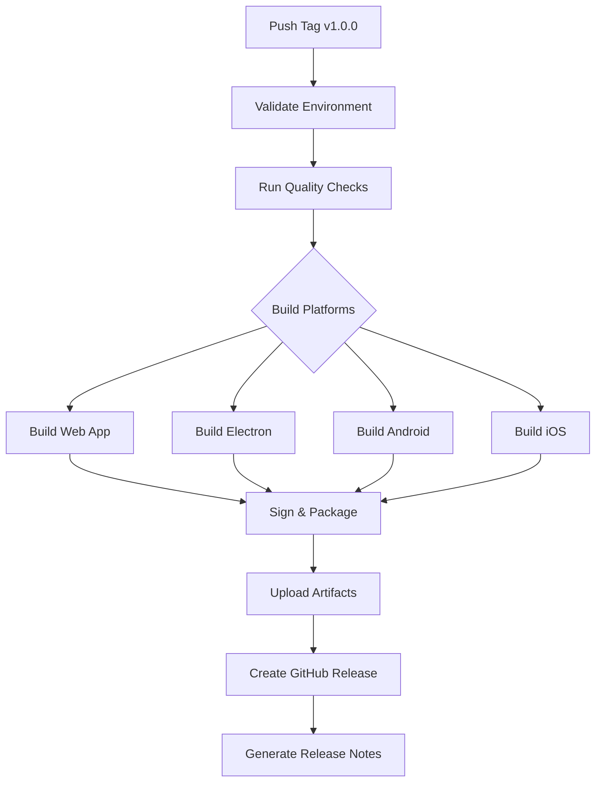

# 🚀 ATC-APP Production Guide

> **Complete reference for production builds, code signing, and automated releases**

This document is the **operational guide** for deploying ATC-APP across all platforms. It covers CI/CD pipelines, signing configurations, release workflows, and troubleshooting.

---

## 📋 Table of Contents

- [Overview](#-overview)
- [Release Workflow](#-release-workflow)
- [Platform Builds](#-platform-builds)
- [Code Signing](#-code-signing)
- [GitHub Secrets](#-github-secrets-reference)
- [CI/CD Pipelines](#-cicd-pipelines)
- [Manual Builds](#-manual-production-builds)
- [Troubleshooting](#-troubleshooting)
- [Post-Release](#-post-release-checklist)

---

## 🎯 Overview

ATC-APP uses **GitHub Actions** for fully automated multi-platform releases with code signing support.

### Supported Platforms

| Platform    | Output Format    | Build Tool              | Signing              |
| ----------- | ---------------- | ----------------------- | -------------------- |
| **Windows** | `.exe` installer | Electron Builder (NSIS) | Code signing cert    |
| **macOS**   | `.dmg`, `.pkg`   | Electron Builder        | Notarization         |
| **Android** | `.apk`, `.aab`   | Gradle + Capacitor      | Keystore             |
| **iOS**     | `.ipa`           | Xcode + Capacitor       | Provisioning profile |

### Release Triggers

| Trigger                 | Behavior                           |
| ----------------------- | ---------------------------------- |
| **Tag push** (`v*.*.*`) | Builds all platforms automatically |
| **Manual dispatch**     | Choose specific platforms to build |

---

## 🔄 Release Workflow

### Automated Release Process



### Step-by-Step Process

1. **Version Tagging**

   ```bash
   git tag v1.0.0
   git push origin v1.0.0
   ```

2. **Validation Phase**

   - Extract version from tag
   - Verify environment (Node, Java, SDKs)
   - Run linting and type checks

3. **Build Phase** (Parallel execution)

   - Web app build (base for all platforms)
   - Electron desktop build (macOS)
   - Android APK build
   - iOS IPA build

4. **Signing & Packaging**

   - Code signing for Windows/macOS
   - Keystore signing for Android
   - Provisioning profile for iOS

5. **Release Publication**
   - Upload artifacts to GitHub
   - Generate release notes
   - Create GitHub Release

---

## 🏗️ Platform Builds

### Web Application

**Base build required for all platforms**

```bash
pnpm --filter @atc-app/app build
```

**Output**: `packages/app/dist/`

**Build Time**: ~2-3 minutes

---

### Electron (Desktop)

#### macOS

```bash
pnpm --filter @atc-app/electron build
pnpm --filter @atc-app/electron exec electron-builder --mac
```

**Outputs**:

- `ATC-APP-{version}.dmg` (installer)
- `ATC-APP-{version}-mac.zip` (portable)

**Build Time**: ~5-7 minutes

**Requirements**:

- macOS runner (self-hosted or GitHub-hosted)
- Apple Developer certificate (`.p12`)
- App-specific password for notarization

#### Windows

```bash
pnpm --filter @atc-app/electron exec electron-builder --win
```

**Outputs**:

- `ATC-APP-Setup-{version}.exe` (NSIS installer)

**Requirements**:

- Windows runner
- Code signing certificate (`.pfx`)

#### Linux

```bash
pnpm --filter @atc-app/electron exec electron-builder --linux
```

**Outputs**:

- `ATC-APP-{version}.AppImage`
- `ATC-APP-{version}.deb`
- `ATC-APP-{version}.rpm`

---

### Android

```bash
# Sync Capacitor
pnpm --filter @atc-app/mobile exec cap sync android

# Build release APK
cd packages/mobile/android
./gradlew assembleRelease
```

**Output**: `packages/mobile/android/app/build/outputs/apk/release/app-release.apk`

**Build Time**: ~8-10 minutes

**Requirements**:

- Java 21+
- Android SDK
- Release keystore

**Keystore Setup**:

```bash
# Decode keystore from base64
echo "$ANDROID_KEYSTORE_BASE64" | base64 --decode > release.keystore

# Sign APK
jarsigner -keystore release.keystore app-release-unsigned.apk alias_name
zipalign -v 4 app-release-unsigned.apk app-release.apk
```

---

### iOS

```bash
# Sync Capacitor
pnpm --filter @atc-app/mobile exec cap sync ios

# Install CocoaPods dependencies
cd packages/mobile/ios/App
pod install

# Build for device
xcodebuild \
  -workspace App.xcworkspace \
  -scheme App \
  -configuration Release \
  -sdk iphoneos \
  -archivePath build/App.xcarchive \
  archive

# Create IPA
xcodebuild \
  -exportArchive \
  -archivePath build/App.xcarchive \
  -exportPath build \
  -exportOptionsPlist ExportOptions.plist
```

**Output**: `packages/mobile/ios/App/build/App.ipa`

**Build Time**: ~12-15 minutes

**Requirements**:

- macOS with Xcode 15+
- Apple Developer certificate
- Provisioning profile

---

## 🔐 Code Signing

### Windows Code Signing

**Certificate Types**:

- EV (Extended Validation) - Recommended for distribution
- Standard code signing certificate

**Setup**:

1. Obtain `.pfx` certificate from CA
2. Convert to base64: `base64 -w 0 certificate.pfx`
3. Add to GitHub Secrets

**Electron Builder Config**:

```yaml
win:
  certificateFile: certificate.pfx
  certificatePassword: ${CSC_KEY_PASSWORD}
  signingHashAlgorithms: ['sha256']
  target:
    - nsis
```

---

### macOS Code Signing & Notarization

**Requirements**:

- Apple Developer Program membership ($99/year)
- Developer ID Application certificate
- App-specific password (not Apple ID password)

**Certificate Setup**:

1. Generate certificate in Xcode or Apple Developer portal
2. Export as `.p12` file
3. Convert to base64: `base64 -w 0 certificate.p12`

**Notarization Process**:

```bash
# Electron Builder handles this automatically
xcrun notarytool submit app.dmg \
  --apple-id "$APPLE_ID" \
  --password "$APPLE_ID_PASSWORD" \
  --team-id "$TEAM_ID"
```

**Electron Builder Config**:

```yaml
mac:
  hardenedRuntime: true
  gatekeeperAssess: false
  entitlements: build/entitlements.mac.plist
  entitlementsInherit: build/entitlements.mac.plist
  notarize:
    teamId: ${TEAM_ID}
```

---

### Android Keystore

**Generate Keystore**:

```bash
keytool -genkey -v \
  -keystore atc-app-release.keystore \
  -alias atc-app \
  -keyalg RSA \
  -keysize 2048 \
  -validity 10000
```

**Convert to Base64**:

```bash
base64 -w 0 atc-app-release.keystore > keystore.txt
```

**Gradle Configuration**:

```gradle
// android/app/build.gradle
android {
    signingConfigs {
        release {
            storeFile file('atc-app-release.keystore')
            storePassword System.getenv('ATC_APP_RELEASE_STORE_PASSWORD')
            keyAlias System.getenv('ATC_APP_RELEASE_KEY_ALIAS')
            keyPassword System.getenv('ATC_APP_RELEASE_KEY_PASSWORD')
        }
    }
}
```

---

### iOS Provisioning

**Setup**:

1. Create App ID in Apple Developer portal
2. Generate Distribution certificate
3. Create Distribution provisioning profile
4. Download and encode: `base64 -w 0 profile.mobileprovision`

**Xcode Configuration**:

- Set Team ID in project settings
- Select provisioning profile for Release builds
- Enable "Automatically manage signing" (or manually specify)

---

## 🔑 GitHub Secrets Reference

### Required Secrets

Configure these in: **Repository Settings → Secrets and Variables → Actions**

#### Application Configuration

| Secret            | Description             | Example                   |
| ----------------- | ----------------------- | ------------------------- |
| `VITE_API_URL`    | Enterprise IDP endpoint | `https://api.company.com` |
| `VITE_VPN_SERVER` | Enterprise VPN server   | `vpn.company.com`         |

#### Windows Signing

| Secret                  | Description              | Format                     |
| ----------------------- | ------------------------ | -------------------------- |
| `CSC_LINK`              | Code signing certificate | Base64 `.pfx` or HTTPS URL |
| `CSC_KEY_PASSWORD`      | Certificate password     | String                     |
| `WIN_CERT_SUBJECT_NAME` | Certificate common name  | Optional string            |

#### macOS Signing

| Secret              | Description              | Format                                     |
| ------------------- | ------------------------ | ------------------------------------------ |
| `APPLE_ID`          | Apple Developer email    | `developer@company.com`                    |
| `APPLE_ID_PASSWORD` | App-specific password    | [Generate here](https://appleid.apple.com) |
| `TEAM_ID`           | Apple Team ID            | `ABC123DEF4`                               |
| `CSC_LINK`          | Distribution certificate | Base64 `.p12`                              |
| `CSC_KEY_PASSWORD`  | Certificate password     | String                                     |

#### Android Signing

| Secret                      | Description       | Format             |
| --------------------------- | ----------------- | ------------------ |
| `ANDROID_KEYSTORE_BASE64`   | Release keystore  | Base64 `.keystore` |
| `ANDROID_KEYSTORE_PASSWORD` | Keystore password | String             |
| `ANDROID_KEY_ALIAS`         | Key alias name    | String             |
| `ANDROID_KEY_PASSWORD`      | Key password      | String             |

#### iOS Signing

| Secret                 | Description              | Format                    |
| ---------------------- | ------------------------ | ------------------------- |
| `APPLE_ID`             | Apple Developer email    | Same as macOS             |
| `APPLE_ID_PASSWORD`    | App-specific password    | Same as macOS             |
| `TEAM_ID`              | Apple Team ID            | Same as macOS             |
| `IOS_CERT_BASE64`      | Distribution certificate | Base64 `.p12`             |
| `IOS_PROVISION_BASE64` | Provisioning profile     | Base64 `.mobileprovision` |

#### GitHub & Publishing

| Secret         | Description        | Auto-Generated |
| -------------- | ------------------ | -------------- |
| `GITHUB_TOKEN` | Release publishing | ✅ Yes         |

---

## 🤖 CI/CD Pipelines

### Release Pipeline (`release.yml`)

**Location**: `.github/workflows/release.yml`

**Triggers**:

- Tag push matching `v*.*.*`
- Manual workflow dispatch

**Manual Dispatch Options**:

```yaml
inputs:
  version: '1.0.0'
  build_web: true
  build_electron: true
  build_android: true
  build_ios: true
```

**Jobs**:

1. **validate**

   - Extract version
   - Set build flags
   - Run quality checks

2. **build-web**

   - Build Vue application
   - Upload artifact

3. **build-electron**

   - Download web build
   - Build Electron
   - Sign and package
   - Upload artifacts

4. **build-android**

   - Download web build
   - Sync Capacitor
   - Build and sign APK
   - Upload artifact

5. **build-ios**

   - Download web build
   - Sync Capacitor
   - Install pods
   - Build and package IPA
   - Upload artifact

6. **create-release**

   - Download all artifacts
   - Generate release notes
   - Create GitHub Release
   - Upload artifacts

7. **release-summary**
   - Generate workflow summary
   - Report build status

**Features**:

- ✅ Selective platform builds
- ✅ Parallel execution
- ✅ Artifact caching
- ✅ Self-hosted runner support
- ✅ Automatic cleanup

---

### CI Pipeline (`ci.yml`)

**Location**: `.github/workflows/ci.yml`

**Triggers**:

- Push to `main`, `develop`
- Pull requests

**Jobs**:

1. **quality**

   - Prettier check
   - ESLint
   - TypeScript check
   - Environment verification

2. **build-web**

   - Build web application
   - Upload artifact

3. **build-electron**

   - Build Electron (no packaging)
   - Verify build output

4. **validate-mobile**

   - Capacitor sync
   - Verify Android assets
   - Verify iOS assets

5. **ci-success**
   - Check all job statuses
   - Generate summary

---

### Security Pipeline (`security.yml`)

**Location**: `.github/workflows/security.yml`

**Triggers**:

- Push to `main`, `develop`
- Pull requests to `main`
- Weekly schedule (Monday 00:00 UTC)
- Manual dispatch

**Jobs**:

1. **audit**

   - PNPM dependency audit
   - Generate vulnerability report

2. **outdated**

   - Check for outdated packages
   - Generate report

3. **secrets**
   - TruffleHog secret scanning
   - Check for leaked credentials

---

## 🛠️ Manual Production Builds

### Prerequisites

Ensure all tools are installed:

```bash
pnpm verify:env
```

### Desktop (Electron)

**Full release build**:

```bash
pnpm release
```

This command:

1. Verifies environment
2. Builds web + Electron
3. Creates platform installers
4. Runs `standard-version`
5. Updates `CHANGELOG.md`

**Platform-specific**:

```bash
# Current platform only
pnpm dist:electron

# Specific platform
pnpm --filter @atc-app/electron exec electron-builder --mac
pnpm --filter @atc-app/electron exec electron-builder --win
pnpm --filter @atc-app/electron exec electron-builder --linux
```

---

### Mobile (Android)

**Release APK**:

```bash
pnpm android:release
```

**Manual steps**:

```bash
# 1. Build web app
pnpm --filter @atc-app/app build

# 2. Sync Capacitor
pnpm --filter @atc-app/mobile exec cap sync android

# 3. Build APK
cd packages/mobile/android
./gradlew assembleRelease

# Output: app/build/outputs/apk/release/app-release.apk
```

**Debug APK**:

```bash
cd packages/mobile/android
./gradlew assembleDebug
```

---

### Mobile (iOS)

**Release IPA**:

```bash
pnpm ios:release
```

**Manual steps**:

```bash
# 1. Build web app
pnpm --filter @atc-app/app build

# 2. Sync Capacitor
pnpm --filter @atc-app/mobile exec cap sync ios

# 3. Install dependencies
cd packages/mobile/ios/App
pod install

# 4. Build
xcodebuild \
  -workspace App.xcworkspace \
  -scheme App \
  -configuration Release \
  -sdk iphoneos \
  -derivedDataPath build

# 5. Create IPA
cd build/Build/Products/Release-iphoneos
mkdir Payload
cp -r App.app Payload/
zip -r App.ipa Payload
rm -rf Payload
```

---

## 🔧 Troubleshooting

### Common Issues

#### 1. Electron Builder Errors

**Issue**: `Cannot read channel`

**Cause**: Missing `repository` field in `package.json`

**Solution**:

```json
{
  "repository": {
    "type": "git",
    "url": "https://github.com/IuriiKyrylovskyi/atc-app"
  }
}
```

---

#### 2. macOS Notarization Failed

**Issue**: Notarization timeout or rejection

**Causes**:

- Invalid Apple ID credentials
- App-specific password not generated
- Missing entitlements
- Unsigned nested binaries

**Solutions**:

```bash
# Verify credentials
xcrun notarytool history \
  --apple-id "$APPLE_ID" \
  --password "$APPLE_ID_PASSWORD" \
  --team-id "$TEAM_ID"

# Check entitlements
codesign -d --entitlements :- App.app

# Sign all binaries
find App.app -type f -perm +111 -exec codesign --force --sign "$IDENTITY" {} \;
```

---

#### 3. Android Build Unsigned

**Issue**: APK not signed after build

**Cause**: Keystore not decoded or environment variables missing

**Solution**:

```bash
# Verify keystore exists
ls -l packages/mobile/android/app/atc-app-release.keystore

# Check environment variables
echo $ATC_APP_RELEASE_STORE_PASSWORD
echo $ATC_APP_RELEASE_KEY_ALIAS

# Manual signing
jarsigner -keystore atc-app-release.keystore \
  app-release-unsigned.apk \
  atc-app
```

---

#### 4. iOS Build Failed

**Issue**: Code signing error or provisioning profile mismatch

**Causes**:

- Expired certificate
- Wrong bundle identifier
- Missing provisioning profile

**Solutions**:

```bash
# List available identities
security find-identity -v -p codesigning

# Verify provisioning profile
security cms -D -i profile.mobileprovision

# Clean Xcode cache
rm -rf ~/Library/Developer/Xcode/DerivedData/*
rm -rf ~/Library/Caches/com.apple.dt.Xcode
```

---

#### 5. GitHub Release Skipped

**Issue**: Release not created

**Causes**:

- Missing `GITHUB_TOKEN`
- Insufficient permissions
- Tag already exists

**Solutions**:

```bash
# Verify token permissions in workflow
permissions:
  contents: write
  packages: write

# Delete and recreate tag
git tag -d v1.0.0
git push origin :refs/tags/v1.0.0
git tag v1.0.0
git push origin v1.0.0
```

---

#### 6. Self-Hosted Runner Issues

**Issue**: Runner not picking up jobs

**Solutions**:

```bash
# Check runner status
cd actions-runner
./run.sh

# Restart runner service
./svc.sh stop
./svc.sh start

# Update runner
./config.sh remove
./config.sh --url https://github.com/IuriiKyrylovskyi/atc-app --token YOUR_TOKEN
./svc.sh install
./svc.sh start
```

---

### Build Time Optimization

| Optimization           | Impact        | Implementation                          |
| ---------------------- | ------------- | --------------------------------------- |
| **Dependency caching** | 30-50% faster | Use `cache: 'pnpm'` in setup-node       |
| **Parallel builds**    | 2-3x faster   | Use job dependencies, not sequential    |
| **Incremental builds** | 20-40% faster | Use `--frozen-lockfile`                 |
| **Artifact reuse**     | 50-70% faster | Build web once, reuse for all platforms |

---

## ✅ Post-Release Checklist

After a successful release:

### 1. Verify Artifacts

- [ ] GitHub Release created with correct tag
- [ ] All platform artifacts uploaded
- [ ] Release notes generated correctly
- [ ] Changelog updated

### 2. Test Installers

- [ ] Download and install Windows `.exe`
- [ ] Download and install macOS `.dmg`
- [ ] Install Android APK on physical device
- [ ] Install iOS IPA via TestFlight or Xcode

### 3. Validate Functionality

- [ ] Application launches without errors
- [ ] Core features work as expected
- [ ] No console errors or warnings
- [ ] Version number correct in app

### 4. Update Documentation

- [ ] Update `CHANGELOG.md`
- [ ] Update version badges in README
- [ ] Document breaking changes
- [ ] Update migration guides

### 5. Communicate Release

- [ ] Notify team via Slack/Discord
- [ ] Send email to stakeholders
- [ ] Update project management boards
- [ ] Post release announcement

### 6. Archive Artifacts

- [ ] Backup signed builds to secure storage
- [ ] Archive source code snapshots
- [ ] Store build configurations
- [ ] Update asset management system

---

## 📊 Build Artifacts Reference

| Platform    | File                          | Size (Approx) | Location                                                 |
| ----------- | ----------------------------- | ------------- | -------------------------------------------------------- |
| **Windows** | `ATC-APP-Setup-{version}.exe` | 80-100 MB     | `packages/electron/release/`                             |
| **macOS**   | `ATC-APP-{version}.dmg`       | 90-110 MB     | `packages/electron/release/`                             |
| **macOS**   | `ATC-APP-{version}-mac.zip`   | 85-105 MB     | `packages/electron/release/`                             |
| **Linux**   | `ATC-APP-{version}.AppImage`  | 95-115 MB     | `packages/electron/release/`                             |
| **Android** | `app-release.apk`             | 30-40 MB      | `packages/mobile/android/app/build/outputs/apk/release/` |
| **iOS**     | `App.ipa`                     | 35-45 MB      | `packages/mobile/ios/App/build/`                         |

---

## 🔄 Continuous Improvement

### Metrics to Track

- Build success rate
- Average build time per platform
- Artifact size trends
- Download counts
- Installation failures

### Regular Maintenance

**Weekly**:

- Review security scan reports
- Check for outdated dependencies
- Monitor build performance

**Monthly**:

- Update dependencies
- Review and optimize workflows
- Update documentation

**Quarterly**:

- Audit code signing certificates
- Review runner configuration
- Evaluate new CI/CD features

---

## 📚 Additional Resources

- [Electron Builder Docs](https://www.electron.build/)
- [Capacitor Docs](https://capacitorjs.com/)
- [GitHub Actions Docs](https://docs.github.com/en/actions)
- [Apple Notarization Guide](https://developer.apple.com/documentation/security/notarizing_macos_software_before_distribution)
- [Android App Signing](https://developer.android.com/studio/publish/app-signing)

---

**Last Updated**: November 2025
**Maintainer**: ATC-APP Team
**Questions?**: Open an issue on GitHub
